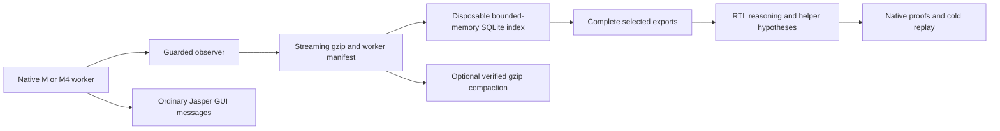

# Telemetry operation

Read the sections needed for the current operation. Qualification binds the exact worker, library/profile, Jasper launcher, running `jipstats` executable, streaming reader, Slurm job script and capture policy. Changes invalidate cached PASS; disk checks certify archived records, while console checks certify frontend records. Adapter/producer changes and historical fault reproductions belong in [telemetry-maintenance.md](telemetry-maintenance.md); current qualification and test dispositions are in [validation.json](validation.json). These tests do not prescribe the user's convergence strategy.

## Architecture and capability limits



The disk sink diverts observer reports before Jasper's report callback, avoiding GUI history retention. Redirecting stdout or compressing the session log afterwards does not remove that retention. The old June console path also truncated an observed 1,054-byte final record at 1,024 bytes; capture before the callback preserves the full record. Native solver operations/arguments/results remain untouched. Ordinary messages still support the GUI.

Every observed record/payload is emitted without a record cap, as bounded chunks into streaming gzip level 1. Cube dedup retains at most 65,536 hash/ID/count entries, without literal copies; eviction re-emits a fresh full definition. Adaptive frames preserve every ordered `(cube_id, packed_flags)` tuple, including duplicates, using 64-member immutable chunks and a bounded 16,384-entry reuse cache. Empty/tiny frames have an atomic declaration; larger frames have an independently checked closure. Live membership, variable-name and obligation state still scale with the native model; this is not a constant-memory theorem. At checkpoints/seals, gzip finishes a CRC-protected member before synchronization and manifest publication. Later records can start another member. Disk/compression failure exits 74 rather than silently losing data. Abrupt termination can still leave an unsealed or unreadable stream.

`full` means complete **observed** data at qualified hooks, not every hidden SAT formula, transition-graph mapping or concrete trace. The two Cadence adapters expose cubes, names, frame snapshots/deltas, predecessor pairs, queries/operations and queues at their qualified boundaries. Native sampled displays remain distinct from full schema payloads.

Membership add/remove records describe set changes; duplicate occurrences and flags remain in the ordered tuples. Adds from an unfinished snapshot are provisional. Apply deltas only after its `frames_end complete=1`; a failed scan rolls back new internal entries so a later successful scan can re-emit them.

## Installations and launch

Supported exact workers:

| Installation | Worker SHA prefix | Capability |
|---|---|---|
| `/projects/external_ip/cadence/jasper_2026.0920260826065032` | `b5006df1` | Qualified full-detail ABI |
| `/projects/external_ip/cadence/jasper_2026.06p002` | `e8cbfa93` | Full-detail ABI; old Dollar named renderer/getCex convenience hook unqualified |

Unknown hashes fail closed. Qualification keys include worker, profile, library, launcher and capture/transport policy. Another release's PASS or a previous producer's PASS is insufficient. `--check` compares M/M4 native proof/CEX fixtures with and without instrumentation; it is not a target proof or universal hidden-formula certificate. Fresh checks use RUN/cache; logs identify fresh/cached provenance, native job and timestamp. To reuse one, pass `XDG_CACHE_HOME=CHECK/cache` through `PASS_ENV`.

The current development launcher defaults to disk/full/gzip with `tuple_chunks_v2`; direct launches without `--evidence-dir` print a fresh capture directory in the working directory. Slurm supplies an explicit shared directory. Console transport is an explicit retention-comparison option. Full-detail qualification uses the same strict streaming reader as analysis, with a disposable index and no uncompressed mirror. It requires standard Python 3 and the complete plugin's `tools/` directory; the launcher's own runtime remains bundled. Reader SHA joins the qualification key. Unreleased candidates and their actual dispositions are recorded in `validation.json`; do not infer that the older primary binary has these defaults.

`check` forces a fresh qualification and updates its cache records. Run it in your own fresh check directory using that directory's cache. To reuse an exact supplied PASS, verify its receipt and component hashes, then pass its cache to the investigation launch; do not point a forced check at a shared owner's cache. Retain the original job/time provenance.

```bash
K=/path/to/installed/plugin
# LM_LICENSE_FILE must already identify the authorized license server.
JASPER=/projects/external_ip/cadence/jasper_2026.06p002 \
  "$K/slurm/submit.sh" check /shared/check-june
"$K/slurm/submit.sh" licenses
"$K/slurm/submit.sh" diagnostic /shared/diag /project/run_fv /shared/diagnostic.tcl
PASS_ENV='IC3_TCLDIR REPO_ROOT' "$K/slurm/submit.sh" batch /shared/graph /project/run_fv /shared/graph.tcl
```

All native processes use Formal/Formal_192G; no emulation. Set variables per command and use absolute workspace paths. `PASS_ENV` passes extra project variables through a clean environment. Each parallel run needs its own writable project/common dispatcher/ProofMaster, sharing only pinned immutable inputs. Top-level Jasper `-tcl` can see empty `[info script]`; use an explicitly passed `IC3_TCLDIR`/`AGENT_DIR` for sibling setup paths. Counted graphs/cold replays run plain batch with unchanged project dispatch and no agent-added timeout. Short warm sessions are optional. Budget elapsed time can exclude elaboration/PRE/ProofGrid queues; record wall time separately. A Tcl timer starts after console startup/license acquisition: distinguish script/prove time from head-process elapsed time and scheduler queue time. If completed jobs are purged and accounting is unavailable, retain native exit/proof receipts and sampled process duration; report missing scheduler state rather than invent completion.

In producer 1.6.13, `sat_end.wall_ns` is the matched call's monotonic duration, not an event timestamp; `elapsed` is process CPU seconds. Pair SAT calls by capture/pid/tid/run/call. Keep thread CPU, process CPU and wall spans separate, and do not add nested or overlapping spans as total proof cost.

For optional session requests, do not call `exit`: end the session with `session_stop`. An `exit` inside a request terminates Jasper before the response is returned.

Resolve assertion names with `get_property_list` after elaboration; a bare RTL label may not resolve in `prove -property`. Check native syntax with `help prove`. Jasper's `clock` shadows Tcl's: use `::tcl::clock::milliseconds` for timing. Double-quoted Tcl substitutes `[...]`, so quote expressions or escape bit selects. A `return` ends a sourced request; do not concatenate such requests blindly. Preserve the project's dispatch for counted comparisons; declare local dispatch experiments separately and include local engines when sizing the allocation.

If a property-list filter is rejected, iterate `get_property_list` and query documented attributes such as `{type disabled converted liveness}`. Preserve the requested enabled target class. Record conversion provenance without excluding an enabled original solely for that provenance. `status=unprocessed` does not establish enabledness; unknown attributes remain unknown. Native proves may ignore disabled names, so inventories do not establish solver cost.

For a warm session, build once and add candidate helpers through `session/send.sh`. Promote certified helpers into the checker/graph before ending a round. Rotate a growing session at a safe boundary, recreating exact setup and reproving prerequisites before `-with_proven`. Changed sources invalidate receipts; `clear -all` removes Tcl asserts. After a crash, verify the allocation and engines ended before relaunching.

`licenses` reports aggregate availability, not a reservation; absent features are not evidence that no license is required. `Waiting for license` means proof has not started. A qualification timeout there exits 75/BLOCKED_LICENSE without an adapter verdict. Use one-shot reads and record pending jobs. Site routing can move small Formal_192G requests into Formal; inspect actual allocation. Both are permitted.

Inspect licensing before parallel batches; exhausted features are a reason to defer redundant heads. A dispatched engine pending for priority is a scheduler wait, not evidence of logical failure. Routing an owned pending job between the two permitted partitions changes the timing context: preserve its command/resources/proof inputs and before/after receipts, and label comparisons accordingly. Do not infer feasibility from idle CPU counts alone. A cancelled pending job can receive identical start/end timestamps with zero runtime and no allocation; use its pre-cancel state, allocation fields and native evidence before claiming execution.

Measure the coordinator and local engines separately from dispatched engine allocations before sizing a new run. Request head memory with measured headroom; excess reservations can block engines even when CPUs are idle. Local proofs need their engines included. Preserve native engine resources and dispatch, freeze allocation choices before a counted comparison, and match the graph/control contexts. Resource cancellations remain interrupted experiments, not logical refutations. No single memory size fits every design.

Four memory quantities are distinct: the Slurm **reservation** (`--mem`, `SLURM_MEM_PER_NODE`; scheduling only, and a step can inherit the job's value instead of its own request), **kernel enforcement** (cgroup v2 `memory.max` is the hard limit, reclaim then OOM; `memory.high` is only a throttle/reclaim threshold, not a cap; the effective bound is the minimum finite value over the process's cgroup *and every ancestor*, so a leaf `max` does not mean unbounded; if any level is unreadable, a finite value elsewhere is only a known upper bound), **native reported limits** (`/proc/PID/limits`; `RLIMIT_RSS` is ignored by modern Linux, see getrlimit(2), so "Max resident set" is not a cap; `RLIMIT_AS`/`RLIMIT_DATA` are enforced when finite), and **measured RAM** (`VmRSS`, `memory.current`/`memory.peak`). Before claiming a cap or reusing an allocation, inspect the actual process on its compute node, e.g. `python3 "$K/tools/memory_limits.py" PID` run inside the allocation (`srun --overlap --jobid=JOB ...`), or with no PID from within the job step itself. It reads only, refuses processes of other users, reports `unlimited`/`unknown`/`missing` and chain completeness explicitly, and marks cgroup v1 or dot-traversal (namespace-mismatch) paths `UNSUPPORTED`. It does not check other memory mechanisms. One node's observation does not describe other nodes, other Slurm configurations or the native solver's internal accounting. When limits change, record the new reservation/enforcement receipt separately and treat later runs as a changed resource context, not a matched performance comparison. The disk telemetry sink removes the report-callback retention path only; it does not bound native solver memory.

Native orchestration may select different engines in a finite diagnostic and a cold replay. Compare the model, certified prerequisites, native settings and orchestration-dependent defaults before attributing a stall to a lemma. For example, `set_prove_invariants_import auto` enables reuse only with orchestration; consult the selected release's manual before changing it. A supported capability is not evidence that invariant sharing actually occurred. A documented engine choice supported by earlier proof evidence is a search strategy, not an added assumption or time limit. Declare and freeze such choices in a separate graph, retain certificate gates, and account for interrupted runs and the changed search context.

A worker cap can exclude requested engines entirely. Check native warnings and actual engine launches as well as the effective job limit; a requested engine list is not evidence that every engine ran. Choose concurrency that fits measured memory while retaining the proof and trace capabilities needed by the current task. A missing previously successful engine is a search-context difference to investigate before revising the lemma or blaming inductiveness.

In local ProofGrid mode, `set_proofgrid_max_jobs` does not bound local engine jobs. Use the selected release's documented `set_proofgrid_max_local_jobs` command and check the native per-prove settings for the effective bound. A successful setter or an unavailable getter is insufficient evidence. Local workers do not inherit shell-dispatcher memory settings. A fresh cold replay inside an owned Formal allocation can supply native certificates under a declared changed dispatch/concurrency context; keep isolated writable projects, ProofMaster off, all model and certificate gates, durable orchestration and exit receipts. Sharing an allocation changes resource contention, so account for it separately from matched performance comparisons. Track the exact child step and head process: a running parent does not establish that its proof is live or complete. Retain cancelled batch job IDs as history and use the actual step/exit receipts for a later local launch; preserve the parent and its controls.

For an `srun` step, set `--ntasks=1 --cpus-per-task=1` for a single-process probe; inherited task counts can launch multiple copies and interleave their output. Verify environment transport before native work. On this installation, `--export=NONE,NAME=value` discarded the explicit value even though the batch submission path worked. Pass the job-environment path as a positional argument, then explicitly export `IC3_JOB_ENV`, `PATH=/usr/bin:/bin` and `USER` from `id -un` inside the compute-node shell before invoking `jasper_job.sh`; its shell reads `USER` before constructing Jasper's clean environment. Test the actual launcher with a fake executable as well as the wrapper. Preserve failed receipts and use a new run directory for a retry.

For long offline ingestion, use a foreground Bash call with a suitable tool timeout, or submit a reader-only shell job through `/netbatch/bin/sbatch --partition=Formal` with explicit CPU/memory, shared absolute input/output paths, logs and an exit receipt. Save its job ID and inspect status once; no Jasper license is needed for the reader. A Claude background Bash task is stopped when the CLI exits, and denied detached-process requests do not create a durable job. Do not finish the session expecting such a task to notify a future invocation. Resume from the durable job receipt; after confirming a failed process ended, remove only its disposable partial index before retrying. Do not use `pgrep -f` as a completion test: it can match the waiting shell itself. These workflow waits add no native proof limit.

## Archive integrity, queries and disk retention

Canonical files are `RUN/telemetry/events-*.log.gz` and worker manifests. `capture.log` contains ordinary messages. Avoid uncompressed mirrors, whole-history details JSON and worker-side databases. The optional offline SQLite index uses DELETE journaling, mmap disabled and an 8 MiB cache; it stores event offsets/references plus complete payload chunks, not another raw log. It does not fix Jasper's separate project-SQLite SIGBUS.

Index only stable files after workers stop:

```bash
python3 "$K/tools/telemetry_db.py" ingest /shared/diag/telemetry /shared/diag/index.db
python3 "$K/tools/telemetry_db.py" summary /shared/diag/index.db
python3 "$K/tools/telemetry_db.py" frame-members /shared/diag/index.db '<exact-key>' 3 2
python3 "$K/tools/telemetry_db.py" frame-members /shared/diag/index.db '<exact-key>' 3 --all-frames > /shared/diag/frontier.tmp && mv /shared/diag/frontier.tmp /shared/diag/frontier.jsonl
python3 "$K/tools/telemetry_db.py" export /shared/diag/index.db --run '<exact-key>' --cube 123
python3 "$K/tools/telemetry_db.py" payload /shared/diag/index.db '<exact-key>' cube 123
python3 "$K/tools/telemetry_db.py" cube-ids /shared/diag/index.db '<exact-key>' --domain jip_formula > /shared/diag/ids.txt
python3 "$K/tools/telemetry_db.py" decode-cubes /shared/diag/index.db '<exact-key>' --ids-file /shared/diag/ids.txt > /shared/diag/decoded.tmp && mv /shared/diag/decoded.tmp /shared/diag/decoded.jsonl
```

No selector truncates output. Frame rows label `native_phase=search` or `post_final_cleanup` from the actual frame event boundary. `frame-members` expands every ordered tuple for either legacy or compact transport; raw `export --phase frame_member` applies only to legacy records. Explicit `--offset`/`--limit` permit display pages without capping the canonical archive or the default export. Cube IDs are run-local: `export --cube` requires `--run`; it includes all source/predecessor/before/after roles once and every referencing compact snapshot. Unknown runs fail. Older indexes require fresh ingestion. `summary` distinguishes the last closed search frame (possibly empty) from an earlier nonempty snapshot and excludes post-final cleanup; neither is a global invariant.

Native initialization registers the actual Jip/ICSeq pair and model epoch. Aborted attempts receive a distinct `run_abort_seal` with no invented final or proof result. A native final can be followed by clause cleanup: `native_tail_begin` preserves that data while separating it from the search frontier. Reinitialization or normal worker exit closes the tail. `native_validation_abort` links an observed outer-validator unwind to its exact abort event: `aborted_inconclusive` never means validation passed or a reachable counterexample. An inner abort can leave the outer validator live. `summary` reports validation disposition separately from transport completeness; even a normal return is not a proof certificate. Solver unknown/limit results stay inconclusive, and SAT refutes only the local check. Missing expected validation remains explicitly incomplete; resumed search in a cleanup tail fails capture. Unbound/ambiguous hooks invalidate the entire worker manifest even if individual runs say complete. Unique registered seq binding is not a universal native-object lifetime certificate. These lifecycle formats require the streaming reader; the small legacy analyser rejects them.

Ingest verifies sequence/hash chains, payload reconstruction, manifest count/tip and gzip CRC. Strict mode requires sealed runs and closed worker manifests. Diagnostic `--allow-incomplete` labels unsealed captures incomplete and still checks exact nonzero tails. In producer 1.6.4, manifest `sealed=false` also covers a terminal `run_seal` whose `capture_status=incomplete`: closure of transport does not certify balanced native operations or complete semantics. The reader accepts that combination only as incomplete, after verifying the exact manifest tail. A readable unclosed worker is accepted only with this flag and every nonempty run sealed; it remains incomplete. Unsealed unclosed workers and damaged gzip are rejected. If a losing engine left unreadable data, preserve it and the failed index; explicit `--closed-workers-only --allow-incomplete` can inspect closed workers and records every excluded file/reason. That subset is never the whole capture. Compare expected remote dispatches with actual attachments: manifests cannot discover wholly unobserved workers.

Successful ingestion closes SQLite, then writes `INDEX.db.integrity.json`. Keep it with the index; old indexes require fresh ingestion, never an arbitrary checksum for an untrusted cache. Each query verifies index SHA/length and every source's decoded SHA/length/CRC before output and again at completion, with 1 MiB buffers. This detects accidental source/cache changes and persistent concurrent writes, including coarse shared-filesystem mtimes. A failed command may already have printed a prefix: discard it; publish temporary outputs only after exit 0. These trusted checksums are not authentication against rewriting both data and receipts. Batch queries share the two source passes and two index hash passes.

Decode only same-run `jip_formula` literals using captured shift/sign and retained name inversion (`retained_name_inverted`). SAT-raw literals have a different unqualified encoding. Missing/composite/empty names, unresolved RTL roles and absent vector bits stay unknown; verify RTL widths before reconstructing vectors. A valid zero-byte terminal name chunk is not a missing whole name. Operation IDs/nesting distinguish multiple native init calls in one run; budget-stopped unmatched begins stay unmatched. Property names are not yet provably mapped to every worker/run: retain per-prove/dispatch receipts and label ambiguous associations.

`native-display` streams tagged `NATIVE_IC3_REPORT` text only. Never substitute it for full cubes or invent identities for untagged projections. Validation-stage outcomes aggregate checks seen so far in that run; a pass with `checks=0` reports an empty conjunction at an observed boundary, not a property certificate. Legacy `jipstats --analyse --details` and `basis.py` load substantial history: use only a deliberately small complete selected run. Statistical name voting, merging M/M4 IDs, unknown-as-zero and CTI-as-reachable labels are forbidden.

For minimal retained space, keep compressed canonical records/manifests plus small native/evaluation receipts. Delete disposable indexes, their integrity receipts and temporary exports when no longer needed; retain small disposal/hash receipts needed for audit. After all workers close, `archive_pack.py DIRECTORY --recompress` verifies exact decoded SHA/length and stability, then atomically keeps a smaller gzip-9 result. Decoded bytes/offsets stay unchanged; rebuild indexes if source paths move. Unlimited exact history has no finite disk quota: stop cleanly with an explicit incomplete diagnostic at capacity, rather than cap or truncate evidence.

The optional post-close codec stores derived per-record chain hashes implicitly. Use the qualified reader for `.log.chainpack.gz`: it reconstructs every original decoded byte, including the exact hashes and native display records, and checks the decoded SHA/length/count footer and gzip CRC. Normal gzip remains supported. Original decoded offsets still apply; backward seeks replay bounded chain state and can cost more CPU. Batch queries avoid repeating that work.

```sh
python3 "$K/tools/archive_pack.py" RUN/telemetry --chainpack --remove-originals \
  --verified-index INDEX.db > packing-receipts.jsonl
# Source paths changed: dispose the old index and its receipt, then re-ingest.
python3 "$K/tools/telemetry_db.py" ingest RUN/telemetry PACKED.db
```

Stop readers/writers before migration. It requires a complete strict index matching the entire current directory; omit `--verified-index` to build a temporary one. Each file is verified against that index, independently roundtripped, and published exclusively with directory synchronization before removal; a larger result leaves the original intact. Keep the receipts, including exact reader/packer hashes. Unsupported records fail explicitly while retaining the original. The codec supports decoded lines up to 1 MiB and 1,024 simultaneously active runs per file; qualified native records are at most 4 KiB. These are explicit storage-format limits, never capture caps.

Migration is per file: an interrupted directory can contain both ordinary and packed files. Re-ingest that mixture with the current reader. If two encodings of one PID/TID remain after a crash, ingestion rejects them. Compare their full decoded SHA/length using `archive_open`, move the redundant encoding outside the canonical filename pattern, then strictly re-ingest the whole directory before deleting that extra copy. Preserve mismatches and failed evidence. Hidden `.events-*.new` files are unpublished scratch: after confirming the packing process ended, remove them before retrying migration. Other unexpected `events-*.log*` names are rejected. Older readers cannot ingest this format; preserve the matching reader with retained archives.

`summary` outputs JSONL: one metadata object followed by one object per worker/run. Parse it line by line; it is not a single JSON document. Use the public selectors rather than guessing SQLite column names. For a complete frontier, `frame-members … --all-frames` streams the selected closed snapshot in frame order, then invariant frame `-1`, preserving all duplicate tuples and flags. Empty frames emit no membership rows; their declarations remain in scoped `export --snapshot`. The batch shares one before/after integrity verification pair and rejects pagination. Extract unique referenced cube IDs from that export and use `decode-cubes` once; repeated per-frame/per-cube commands repeat verification of every indexed source.

## Display

Set `DIAGNOSTIC_GUI=1` on a diagnostic launch. `with_display.py` creates private Xauthority, Xvnc without X/RFB TCP listeners and a private Unix RFB socket; `xdpyinfo` checks readiness. `display.txt` records allocated node/display/socket; credentials/server are cleaned up at exit. One-shot GUI Tcl ends with `exit -force`, since plain `exit` opens a dialog. Keep the disk sink even in GUI mode.

On the allocated node, set `DISPLAY` and `XAUTHORITY` to the values in `display.txt`. Run `python3 "$K/tools/display_ctl.py" snapshot /shared/screenshot.png` or `key WINDOW_ID Escape`; use `xwininfo -root -tree` to identify the window and inspect a screenshot before input. The tool's `--help` documents these two actions. This was tested on actual Formal displays. For a viewer, use authorized SSH access to the recorded node and a Unix-socket-capable VNC client or loopback-only socat bridge/tunnel. Do not expose a listener or change global X access. A forwarded `localhost:N` belongs to its host and cannot be copied to a compute node. Display runs must stay alive while viewing; batch proofs need no display.

Jasper logs echo Tcl source blocks. Parse anchored emitted receipt/result lines; a failure-marker literal in echoed source is not an executed failure.

For cold proof graphs, process exit 0 is insufficient. Require complete dispositions for every expected node, all dependency gates accepted, native status/validity and cover gates, and absence of Tcl errors. Audit generated Tcl guards as well as successful receipts: assertions require both `status=proven` and `validity_status=proven`; required covers require both `covered`. Compare required cover identities and counts with the emitted receipts; missing rows cannot pass. Reject overconstraint, changed environments and missing prerequisites before reuse. A receipt may show both good fields even when a weak guard checked only one; repair that guard in a fresh hashed replay without rewriting the original evidence. Compare the eligible proved context at each gate with the already certified nodes; account explicitly for original certified facts and native reuse of unreachable covers. Verify source/setup hashes and the original assumption expressions/enables as well as their identities. Preserve the generator receipt linking selected certificates to the final checker and graph. A partially written or missing terminal receipt stays incomplete.

## Maintenance

Edit a clone, rebuild atomically, and never replace a library mapped by running workers. Requalify a changed producer on both exact Cadence workers. Run meaningful transport/archive/semantic tests and actual Claude validation, including helper proof/cold replay and honest capability interpretation. A finite memory comparison is not an exhaustion/production-soak certificate. Update the small skill/agent contract only for reusable lessons; keep reproduction details and measured history in [telemetry-maintenance.md](telemetry-maintenance.md) and `validation.json`.
